# isms-control-evidence-platform

> **Compliance-as-code.** An ISO/IEC 27001:2022 control register mapped to risks, evidence, owners
> and NIS2 readiness — with runnable Linux evidence collectors and a deterministic, hash-manifested
> audit pack.

[](https://github.com/jjsanda/isms-control-evidence-platform/actions/workflows/ci.yml)
[](https://github.com/jjsanda/isms-control-evidence-platform/actions/workflows/codeql.yml)


[](LICENSE)

---

## What is this? (in one picture)

A lightweight **Information Security Management System (ISMS)** for the *fictional* company
**PaketPort Systems GmbH** — an operator of parcel-locker backends and internet-facing **Linux edge
devices**. It shows how security controls are mapped to policies, risks, owners, evidence, audit
status and improvement actions, and how that living register becomes an **auditor-ready audit pack**.

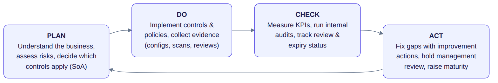

*The whole platform is organised around the ISMS lifecycle above (Plan-Do-Check-Act). It is not a
giant GRC product — it is a small, reviewable evidence workflow that proves the day-to-day mechanics
of running an ISMS: **translate requirements into controls, back them with evidence, track risk and
review status, and hand an auditor a defensible pack.***

The register is **hand-authored YAML validated by Pydantic** — auditable, diff-able and reviewed in
pull requests. Everything runs **offline and deterministically**: no API key, no network at runtime,
and re-running the seed produces byte-identical evidence.

## The ISMS lifecycle in plain language

For a non-technical reader, an ISMS is just a disciplined loop for keeping information safe:

- **Plan** — understand the business, assess the risks, and decide which of the 93 ISO/IEC 27001 controls
  apply (the *Statement of Applicability*).
- **Do** — implement those controls and policies, and collect *evidence* that they actually work
  (configuration checks, vulnerability scans, access reviews, backup tests, training records).
- **Check** — measure how you are doing, run internal audits, and track which evidence is current and
  which reviews are overdue.
- **Act** — fix the gaps with improvement actions, take them to management review, and raise maturity.

This platform makes each of those steps concrete, visible, and reproducible.

> **New to the terms?** The [glossary](docs/glossary.md) explains ISMS, SoA, NIS2, residual risk and
> the rest in plain language.

## Why it's built this way

| Area | Choice | Why it matters for compliance |
| --- | --- | --- |
| **Source of truth** | Human-authored **YAML** + Pydantic `extra="forbid"` | Every change is a reviewed Git diff — the change-control and segregation-of-duties story an auditor wants. ([ADR&nbsp;0001](docs/adr/0001-yaml-as-source-of-truth.md)) |
| **Integrity** | SHA-256 manifest over generated evidence | Evidence artifacts are tamper-evident and hash-anchored, not screenshots in a folder. |
| **Determinism** | One injectable `Clock`, pinned `ICEP_NOW` / `SOURCE_DATE_EPOCH` | Re-seeding is byte-identical (CI proves it), so hashes are meaningful. ([ADR&nbsp;0004](docs/adr/0004-deterministic-clock-and-seed.md)) |
| **Dashboard** | Server-rendered **FastAPI + inline SVG** | "View source" shows the exact numbers; no opaque client bundle, no build step. ([ADR&nbsp;0003](docs/adr/0003-server-rendered-fastapi.md)) |
| **Audit pack** | **WeasyPrint** PDF from the same Markdown sections | One source, two formats — the PDF and Markdown can never disagree. ([ADR&nbsp;0002](docs/adr/0002-weasyprint-for-pdf.md)) |
| **Standards** | ISO/IEC 27001:2022 Annex A + NIS2 Directive (EU) 2022/2555 | Controls, risks and evidence trace to real clauses and articles, not paraphrases. |
| **Engineering** | mypy `--strict`, ruff, 92% coverage, offline gate | The compliance content is backed by production-grade software craft. |

## Architecture

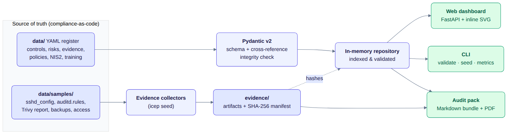

The YAML register is validated into an in-memory repository that every surface reads from; the
collectors turn committed Linux samples into hash-anchored evidence. The relationships between the
entities are explicit:

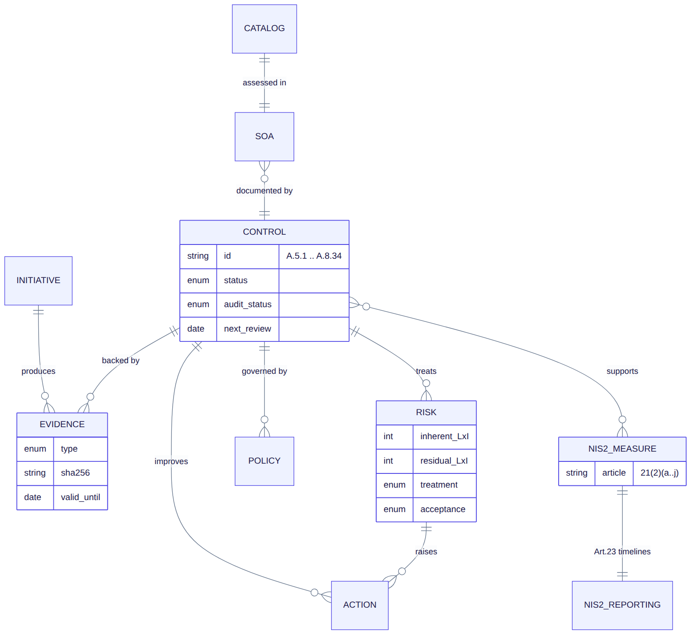

## Quickstart

```bash
make setup              # install dependencies (dev + pdf extra) via uv
make seed-demo-data     # run the collectors -> evidence artifacts + SHA-256 manifest + metrics
make run                # serve the ISMS dashboard at http://127.0.0.1:8000
make export-audit-pack  # build the audit pack (Markdown bundle + PDF + manifest) into dist/
make test               # run the offline test suite (no network, no API key)
```

| Command | What it produces |
| --- | --- |
| `make seed-demo-data` | `evidence/artifacts/*.md` (collector reports + attestations), `evidence/manifest.json` (hashes), `evidence/metrics.json`, `evidence/index.md` — all byte-deterministic |
| `make run` | the dashboard (overview, controls, SoA, risks, NIS2, evidence, awareness, initiative) |
| `make export-audit-pack` | `dist/audit-pack/` — the [committed sample](docs/audit-pack/) shows exactly what it looks like |
| `make ci` | the full local gate: format check, lint, `mypy --strict`, tests+coverage (90% gate), `pip-audit` |

## The dashboard

| Overview (KPIs, status donut, NIS2 bars, risk heatmap) | Control detail (owner, evidence, risks, review) |
| --- | --- |
| [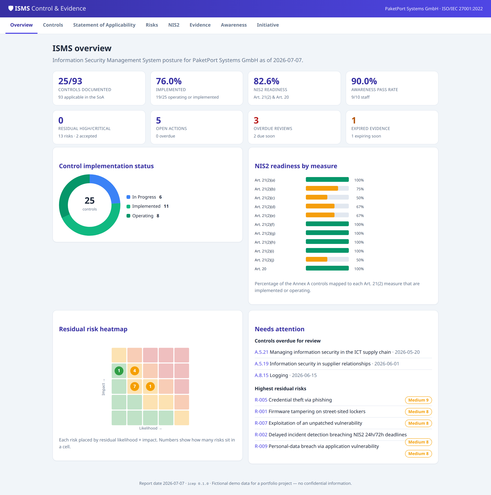](docs/screenshots/overview.png) | [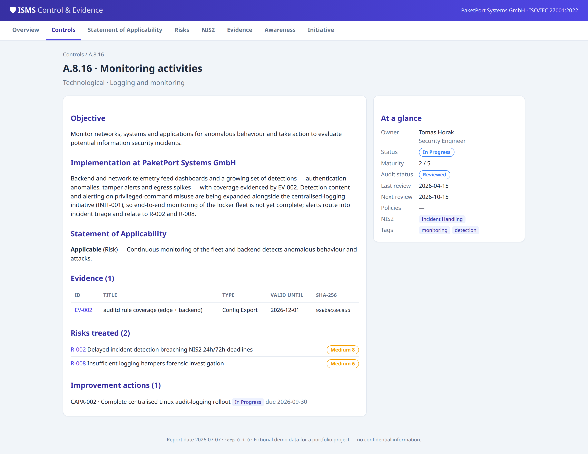](docs/screenshots/control-detail.png) |
| **Risk register + 5×5 heatmap** | **NIS2 Art. 21(2) / Art. 23 mapping** |
| [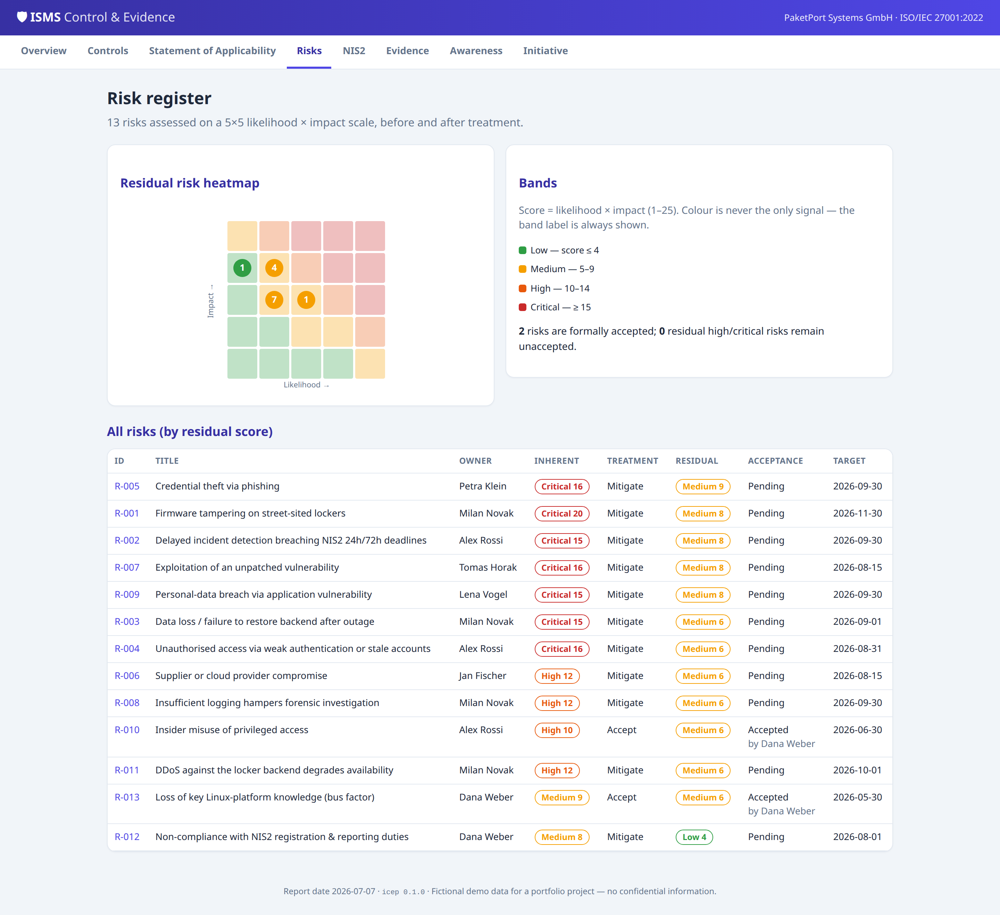](docs/screenshots/risks.png) | [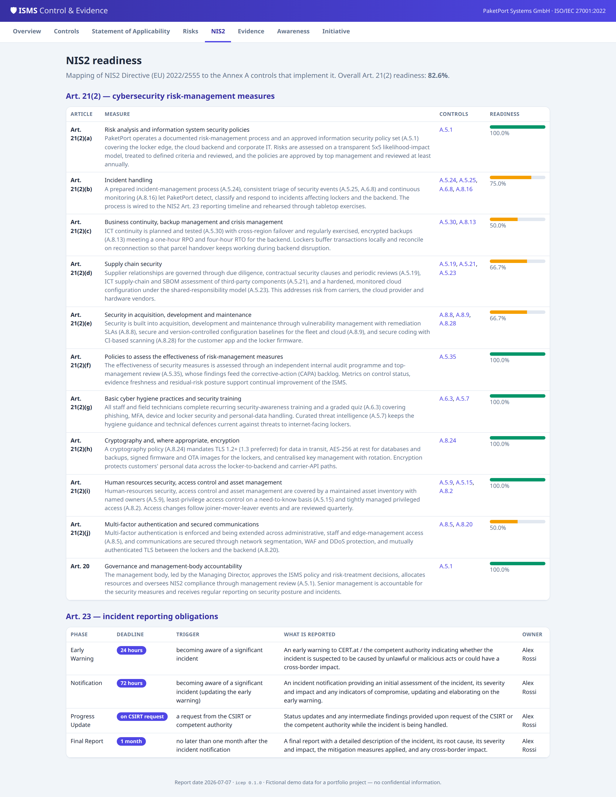](docs/screenshots/nis2.png) |
| **Evidence library (hash-anchored)** | **Awareness training + quiz** |
| [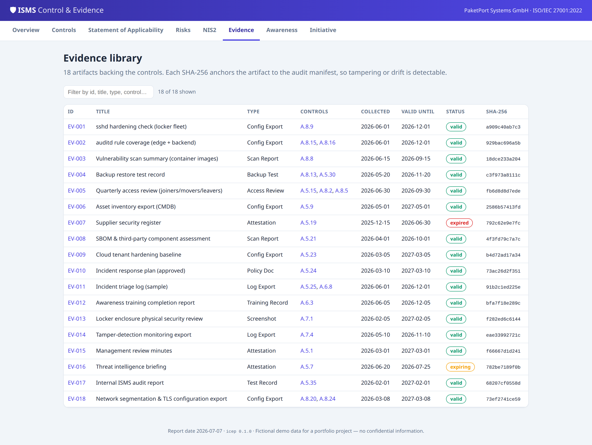](docs/screenshots/evidence.png) | [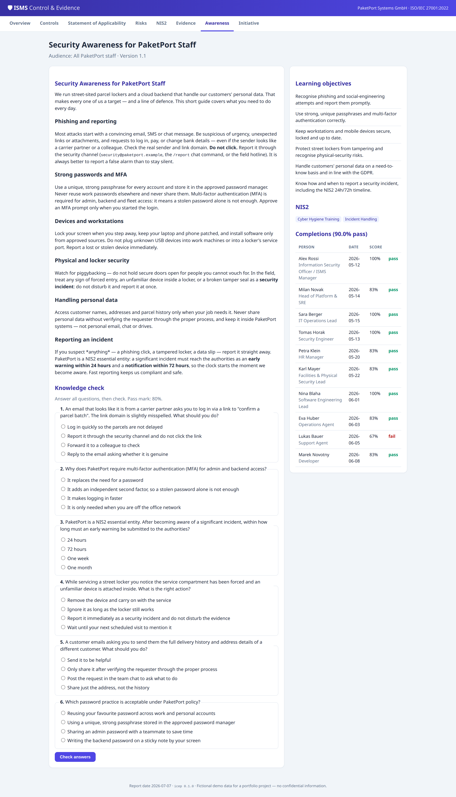](docs/screenshots/training.png) |
| **Control register (filterable)** | **Security initiative — centralised Linux audit logging** |
| [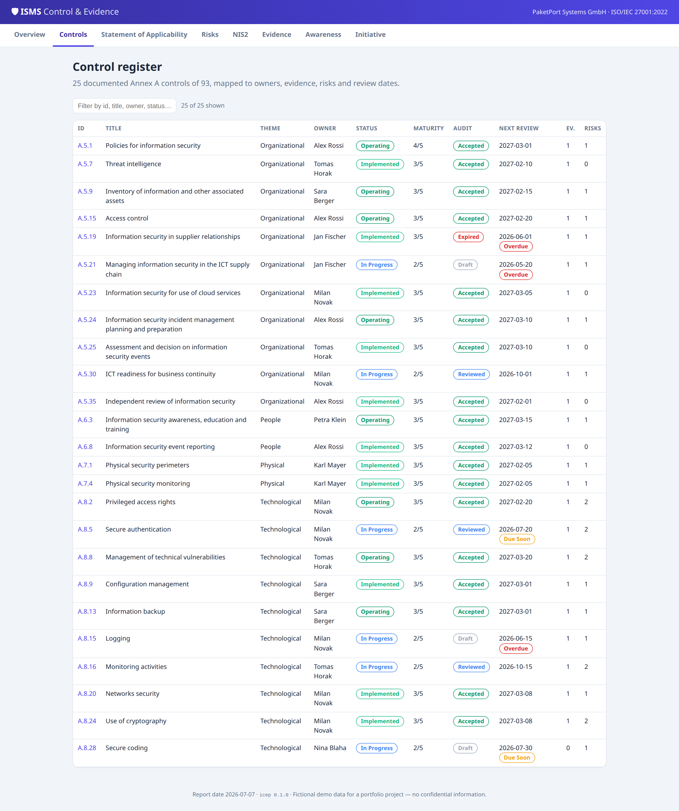](docs/screenshots/controls.png) | [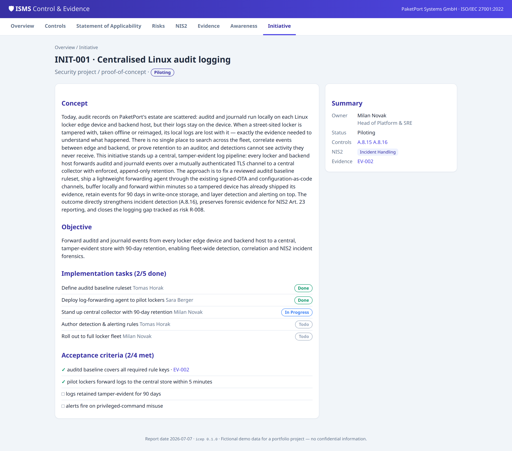](docs/screenshots/initiative.png) |

## The audit pack & certification readiness

`make export-audit-pack` assembles a point-in-time bundle an ISO/IEC 27001 auditor can work through, in
the order they actually work: **executive summary → Statement of Applicability → control register →
risk register → evidence index (with hashes) → NIS2 readiness → improvement actions → audit-status &
expiry**. It is produced as a Markdown bundle *and* a single PDF, sealed by a SHA-256 manifest.

- **A committed sample pack lives in [`docs/audit-pack/`](docs/audit-pack/)** — including the
  [PDF](docs/audit-pack/audit-pack.pdf) and the [Markdown sections](docs/audit-pack/markdown/).
- See [`docs/certification-readiness.md`](docs/certification-readiness.md) for how each artifact maps
  to **Stage 1** (documentation review) and **Stage 2** (implementation audit), and an honest
  what's-ready-vs-gap view (25 of 93 controls are documented in depth; the rest are covered at SoA
  level).

## NIS2 readiness

The register maps the ten **NIS2 Art. 21(2)** cybersecurity risk-management measures (plus the
Art. 20 management-body duty) to the Annex A controls that implement them, and models the **Art. 23**
incident-reporting deadlines (early warning **24 h**, notification **72 h**, final report **1 month**).

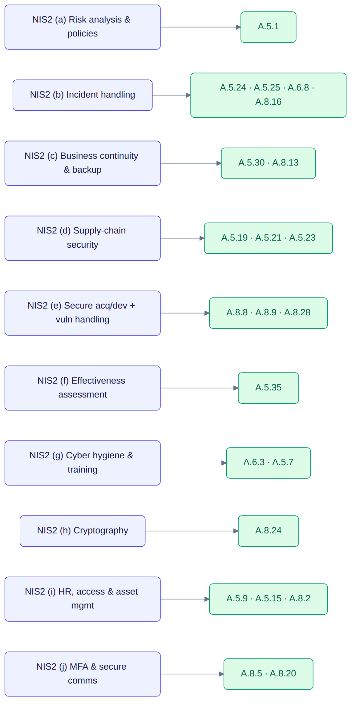

## Evidence collectors — the Linux tie-in

Five small, genuinely-runnable collectors turn committed Linux samples into evidence:

| Collector | Checks | Supports |
| --- | --- | --- |
| `ssh_hardening` | an `sshd_config` against a CIS-style baseline | A.8.9 configuration management |
| `auditd_coverage` | an `auditd.rules` file for required audit coverage | A.8.15/A.8.16 logging & monitoring |
| `vuln_scan` | summarises a Trivy report by severity & SLA | A.8.8 technical vulnerabilities |
| `backup_restore` | backup jobs for restore-test currency & encryption | A.8.13/A.5.30 backup & continuity |
| `access_review` | an access export vs HR joiners/leavers | A.5.15/A.8.2/A.8.5 access control & MFA |

Each produces a Markdown report with pass/warn/fail findings, hashed into the manifest:

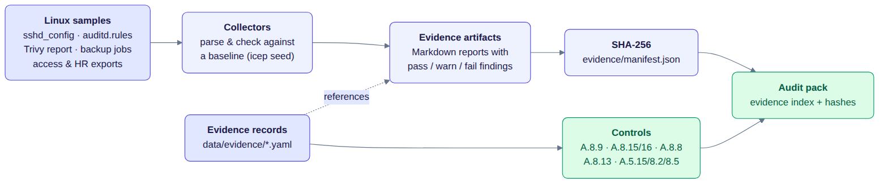

A worked **security initiative** — *"centralised Linux audit logging"* (`INIT-001`) — carries the
concept, implementation tasks and testable acceptance criteria from proof-of-concept to rollout,
linked to the `auditd_coverage` evidence.

## The audit review workflow

Controls and evidence move through a review state machine with segregation of duties (nothing jumps
straight from *draft* to *accepted*) and **time-driven expiry** (an accepted control auto-reads as
*expired* once its review date passes):

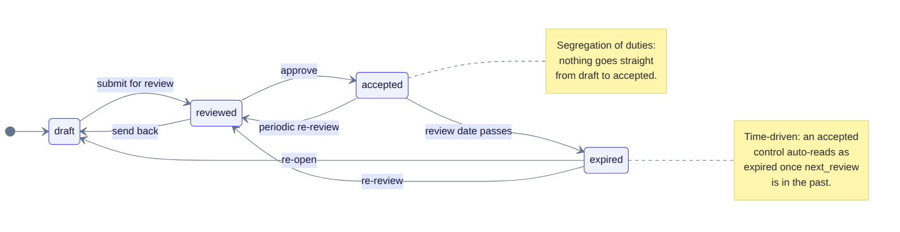

## Project layout

```
data/                 # the ISMS register (YAML): controls, risks, evidence, policies, NIS2, training
  catalog/            #   full ISO/IEC 27001:2022 Annex A catalog (93 controls)
  statement_of_applicability.yaml
  samples/            #   Linux inputs the collectors consume (sshd_config, auditd.rules, ...)
evidence/             # GENERATED by `make seed-demo-data`: artifacts + manifest.json + metrics.json
src/icep/
  domain/             # Pydantic models + enums (control, risk, evidence, policy, NIS2, ...)
  workflow/           # risk scoring, audit state machine, due-date logic
  collectors/         # the five Linux evidence collectors
  seed/  export/  web/ cli.py  loader.py  repository.py  metrics.py  integrity.py
docs/                 # methodology, glossary, certification-readiness, ADRs, diagrams, screenshots
  audit-pack/         # a committed SAMPLE audit pack (Markdown + PDF)
tests/                # unit, integrity, collectors, web, export
```

## Where to find what

| Topic | Where to look |
| --- | --- |
| **ISO/IEC 27001** | the [SoA](data/statement_of_applicability.yaml), the control register, and [`docs/methodology.md`](docs/methodology.md) |
| **NIS2 implementation** | the `/nis2` page, `data/nis2/`, and the Art. 23 timelines |
| **Risk management** | the risk register, 5×5 inherent/residual scoring, and the acceptance workflow |
| **Audit & certification readiness** | the [audit pack](docs/audit-pack/) and [`docs/certification-readiness.md`](docs/certification-readiness.md) |
| **Security engineering (Linux)** | the five [collectors](src/icep/collectors/) and the audit-logging initiative |
| **Documentation** | this README, the diagrams, the glossary, and the ADRs |
| **Software craft** | `mypy --strict`, ruff, 92% coverage, an offline deterministic gate, and CI |

## Testing & quality

- **`make test`** runs fully offline (no network, no API key). `make ci` adds format/lint/type/security.
- **Coverage gate 90%** (currently ~92%); the register itself is tested for schema validity,
  referential integrity (no dangling references), and ISO completeness (93 controls, 37/8/14/34 by
  theme, the 11 new-in-2022 controls).
- **Determinism** is a test: `make seed-demo-data` twice must yield an empty `git diff`.

## Tradeoffs & what's next

- **Representative, not exhaustive** — 25 of 93 controls are documented in depth; a real
  certification push would flesh out the rest and add an external penetration test and a full
  internal-audit programme.
- **Read-only by design** — editing happens through reviewed pull requests to the YAML, not in the
  app. A future iteration could add a proposal/approval UI backed by the same schema.
- **Collectors are illustrative** — they parse committed samples; wiring them to live hosts (SSH,
  scanners, backup APIs) is the natural production step.

## License

[Apache-2.0](LICENSE) © 2026 Josef Šanda. This is a portfolio project; **PaketPort Systems GmbH is
fictional** and no content is confidential (see [NOTICE](NOTICE)).
